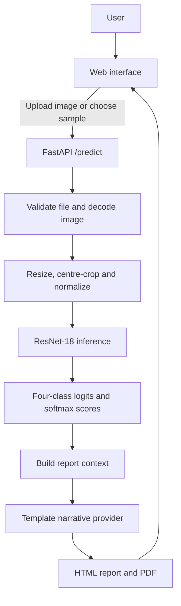
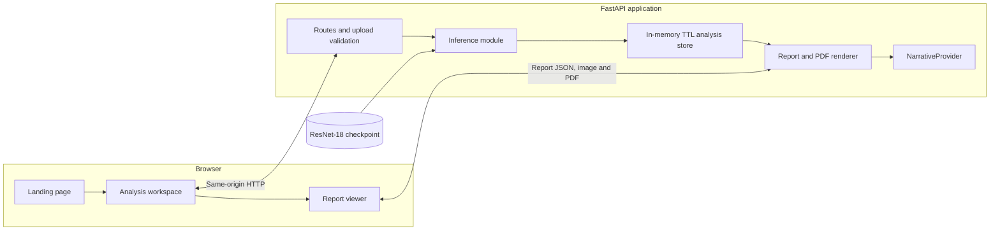
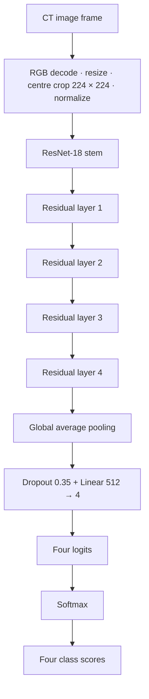
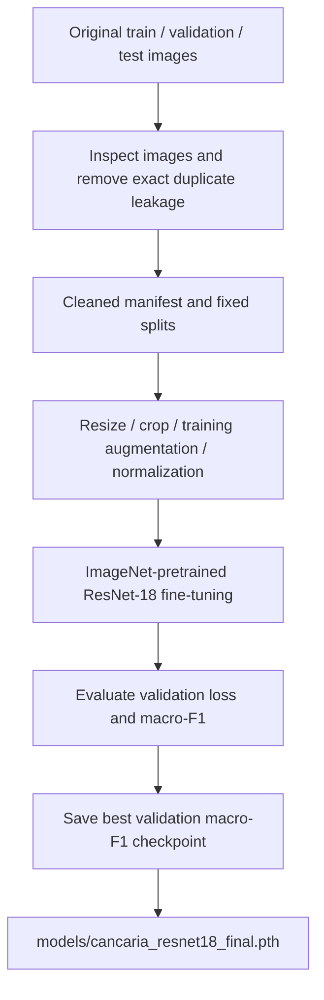

<p align="center">
  
</p>

<h1 align="center">Cancaria</h1>
<p align="center"><strong>Experimental Lung CT Image Classification & Reporting Platform</strong></p>
<p align="center">
  Built for <strong>ML Empowerment Build Challenge 4.0</strong> · Research & education prototype
</p>

<p align="center">
  <a href="https://github.com/epsilon-rbtcs/Cancaria/releases/tag/v1.0.0">Model release</a> ·
  <a href="https://github.com/epsilon-rbtcs/Cancaria">Source code</a>
</p>

---

## About

Cancaria is an experimental four-class lung CT image classifier built for the **ML Empowerment Build Challenge 4.0**. It wraps a fine-tuned **ResNet-18** checkpoint in a web application where a user can upload a single CT image or choose a sample, view the model's four class scores, and generate a structured report with a downloadable PDF.

The classifier predicts one of the labels represented in its training data: **Adenocarcinoma, Large Cell Carcinoma, Normal,** or **Squamous Cell Carcinoma**. It analyses one 2D image frame; it does not process a full CT series.

> **Important:** Cancaria is not a medical device and does not provide a clinical diagnosis, cancer staging, screening decision, or treatment recommendation. Softmax scores are model scores, not calibrated probabilities of disease. Do not use the output to guide healthcare decisions.

## Features

- **Landing page:** product overview, workflow explanation and a clearly marked demonstration-video placeholder.
- **Scan workspace:** drag-and-drop or file-picker upload, four neutral sample images, validation and clear processing states.
- **Real inference:** the saved ResNet-18 checkpoint returns all four class scores.
- **Structured report:** prediction, ranked scores, image, model metadata, generated interpretation and limitations.
- **PDF export:** downloadable ReportLab report.
- **Provider-ready narrative layer:** a deterministic template is used now; the `NarrativeProvider` interface is prepared for a future Gemini or alternative provider. No LLM is called and scan images are not sent to an external AI service.

## How the application works



### Application architecture



## Model and training

### Model design

Cancaria uses an ImageNet-pretrained **ResNet-18** fine-tuned for four classes. The original 1,000-class fully connected layer is replaced with dropout and a four-output classifier. Inference uses a **224 × 224** RGB input.



### Training workflow



The cleaned split contains **846 retained images**: 493 training, 65 validation and 288 test images. The training split contains 194 Adenocarcinoma, 114 Large Cell Carcinoma, 33 Normal and 152 Squamous Cell Carcinoma images. The small dataset—especially the Normal class—limits how confidently results can generalise.

### Training configuration

| Setting | Value |
|---|---:|
| Backbone | ResNet-18, ImageNet pretrained |
| Input | RGB, 224 × 224 |
| Dropout | 0.35 |
| Backbone learning rate | `1e-5` |
| Classifier learning rate | `1e-4` |
| Optimizer | AdamW |
| Weight decay | `1e-4` |
| Loss | Weighted cross-entropy, label smoothing `0.05` |
| Class weighting | Normalized square-root inverse frequency |
| Checkpoint selection | Best validation macro-F1 |

### Mathematical formulation

Let the network produce logits $z_1,\ldots,z_C$, where $C=4$.

**Softmax class score**

$$
 p_c = \frac{e^{z_c}}{\sum_{j=1}^{C} e^{z_j}}, \qquad \sum_{c=1}^{C}p_c=1
$$

The predicted class is $\hat y=\operatorname{argmax}_c p_c$. These values describe the model's relative output scores; they are not calibrated clinical probabilities.

**Square-root inverse-frequency class weights**

For class $c$ with $n_c$ training examples and mean class count $\bar n$:

$$
 \tilde w_c=\sqrt{\frac{\bar n}{n_c}},\qquad
 w_c=\frac{\tilde w_c}{\frac{1}{C}\sum_{j=1}^{C}\tilde w_j}
$$

This gives greater weight to less represented classes while reducing the aggressiveness of plain inverse-frequency weighting.

**Weighted cross-entropy with label smoothing**

For one-hot target $y$, smoothing parameter $\varepsilon=0.05$, and smoothed target $q_c=(1-\varepsilon)y_c+\varepsilon/C$:

$$
 \mathcal L=-\sum_{c=1}^{C} w_c q_c\log(p_c)
$$

**Evaluation metrics**

$$
 \text{Accuracy}=\frac{\text{correct predictions}}{N}
$$

$$
 \text{Balanced Accuracy}=\frac{1}{C}\sum_{c=1}^{C}\text{Recall}_c
$$

$$
 F1_c=2\cdot\frac{\text{Precision}_c\,\text{Recall}_c}{\text{Precision}_c+\text{Recall}_c},\qquad
 \text{Macro-F1}=\frac{1}{C}\sum_{c=1}^{C}F1_c
$$

### Recorded model results

- Best validation macro-F1 stored in the checkpoint: **0.7841**.
- Observed test split: **67.01% accuracy**, **67.29% balanced accuracy**, **68.47% macro-F1**.

The test split was inspected during model development and should not be treated as an untouched independent evaluation. These results are from this small project dataset, not external or clinical validation.

## Run Cancaria locally

### Requirements

- Python 3.11+
- The model checkpoint at `models/cancaria_resnet18_final.pth`
- CPU works; a CUDA-capable NVIDIA GPU can accelerate inference

### 1. Clone and create an environment

```powershell
git clone https://github.com/epsilon-rbtcs/Cancaria.git
cd Cancaria
py -3.11 -m venv .venv
.venv\Scripts\Activate.ps1
python -m pip install --upgrade pip
```

### 2. Install dependencies

```powershell
pip install -r requirements.txt
```

For a specific CUDA build of PyTorch, install the matching `torch` and `torchvision` wheels from the official PyTorch installation selector first, then install the remaining requirements.

### 3. Download the model checkpoint

Download [`cancaria_resnet18_final.pth`](https://github.com/epsilon-rbtcs/Cancaria/releases/download/v1.0.0/cancaria_resnet18_final.pth) from the `v1.0.0` release and place it here:

```text
models/cancaria_resnet18_final.pth
```

Verify the file with SHA-256:

```powershell
Get-FileHash .\models\cancaria_resnet18_final.pth -Algorithm SHA256
```

Expected hash:

```text
a314fd7d309911f7614ddc18c0453a7a7a1b908c46ce1d9cbb3918616a12f199
```

### 4. Start the server

From the repository root:

```powershell
.venv\Scripts\python.exe -m uvicorn api.main:app --host 127.0.0.1 --port 8000
```

Open **http://127.0.0.1:8000**. The interactive API documentation is available at **http://127.0.0.1:8000/docs**.

### 5. Use the application

1. Open the landing page and select **Try Cancaria** (or visit `/analyse`).
2. Upload a PNG, JPEG or WebP image, or choose one of the four neutral sample images.
3. Start analysis and review the predicted class and all four model scores.
4. Open the generated report and download its PDF.

### Use the trained model from Python

Once the checkpoint is in `models/`, the inference helper can be called directly:

```python
from src.predict import predict

result = predict("path/to/ct-image.png")
print(result["prediction"])
print(result["scores"])
```

The checkpoint stores the architecture, class order, display names, input size and normalization metadata. Keep the class order and preprocessing aligned with the checkpoint when changing the inference code.

### Work with or retrain the model

The training and evaluation notebook is `notebooks/cancaria_training-2.ipynb`. Open it in Jupyter from the repository environment and run its cells in order. The source dataset is deliberately not included in Git; place the dataset in the directory structure expected by the notebook before attempting to reproduce training. The notebook documents preprocessing, training, validation, evaluation and confusion-matrix generation.

When experimenting, preserve the validation split for model selection and avoid repeatedly tuning against the test split. Save a new checkpoint separately first; replace `cancaria_resnet18_final.pth` only after checking its class order, input preprocessing, validation metrics and inference compatibility.

### API routes

| Method | Route | Purpose |
|---|---|---|
| `GET` | `/` | Landing page |
| `GET` | `/analyse` | Scan workspace |
| `GET` | `/report?id={id}` | Report viewer |
| `GET` | `/api/health` | Model/device/service status |
| `GET` | `/api/config` | Public client limits and report TTL |
| `POST` | `/predict` | Image classification and report creation |
| `GET` | `/api/report/{id}` | Structured report data |
| `GET` | `/api/report/{id}/image` | Analysed image preview |
| `GET` | `/api/report/{id}/pdf` | Download PDF |

### Input constraints

- Accepted formats: PNG, JPEG and WebP.
- Maximum upload size: 10 MB.
- Minimum dimensions: 32 × 32 pixels; maximum: 40 megapixels.
- One still 2D image only. DICOM series and PDFs are not supported.

## Project structure

```text
Cancaria/
├── api/
│   └── main.py                 # FastAPI routes and upload validation
├── src/
│   ├── predict.py               # ResNet-18 loading and inference
│   ├── analysis_store.py        # In-memory TTL report/image store
│   └── report.py                # Report schema, narrative and PDF renderer
├── web/
│   ├── templates/               # Landing, analysis and report pages
│   └── static/
│       ├── css/                  # Design tokens and page styles
│       ├── js/                   # Frontend interactions
│       └── assets/               # Fonts, images and logo
├── notebooks/                   # Model training and evaluation notebook
├── models/                      # Downloaded checkpoint (not in Git)
├── Data/                        # Local dataset (not served or committed)
├── reports/                     # Local training outputs
├── requirements.txt
├── DESIGN.md
└── README.md
```

## Reports, privacy and limitations

- Analysis records and previews are held in a thread-safe in-memory cache for **30 minutes by default**; the cache is cleared when the server process stops. The TTL can be changed with `CANCARIA_ANALYSIS_TTL_SECONDS`.
- The application does not write uploaded scans to disk. Only `/static` is mounted; `Data/`, `models/` and `reports/` are not served.
- The current report narrative is template-generated. Gemini is not integrated; `NarrativeProvider` is the extension point for a future provider.
- The model examines one 224 × 224 image crop. It does not use multi-slice context, scanner metadata or patient history.
- There is no segmentation, staging, calibrated risk score or treatment guidance.
- Dataset-derived sample imagery and dataset redistribution terms should be checked against the original dataset licence before redistribution.

## License

This repository is distributed under the MIT License; see [`LICENSE`](LICENSE). The model checkpoint and dataset-derived assets may have separate applicable terms. Verify their provenance and redistribution permissions independently.

---

<p align="center"><strong>Cancaria</strong> · An experimental AI image-classification prototype for research and education.</p>
